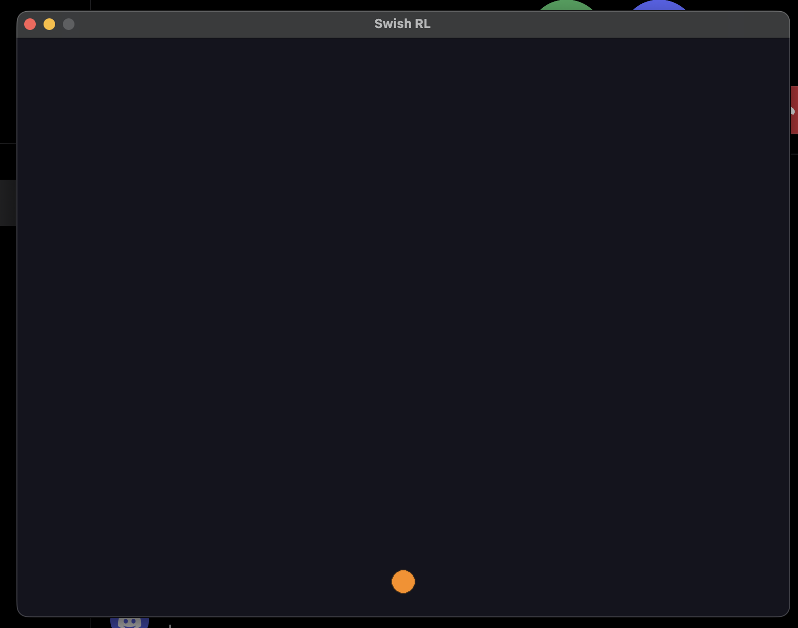

# Swish RL

[](https://github.com/zuromu/swish-rl/actions/workflows/ci.yml)

A 2D basketball game where an AI learns to shoot from scratch using reinforcement learning.

## Run it

You need [uv](https://docs.astral.sh/uv/).

```bash
git clone https://github.com/zuromu/swish-rl.git
cd swish-rl
uv run swish-rl
```

A window opens and a ball falls and bounces on the floor.


## Status

- [x] M0: professional repo setup (CI, pre-commit hooks, templates)
- [x] M1: physics sandbox (gravity, bouncing, fixed-timestep game loop)
- [ ] M2: court, hoop and shooting
- [ ] M3: the AI starts learning
